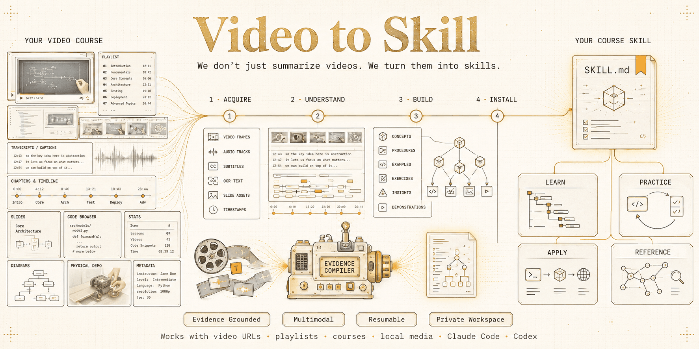

# video-to-skill

Turn a video, playlist, or course into a grounded Agent Skill that your coding agent can teach from, quiz you on, use as a reference, and apply to real projects.

<p align="center">
  
</p>

## What you get

Instead of dumping a raw transcript, `video-to-skill` compiles videos into a portable, on-demand Skill directory:

- `SKILL.md` — concise teaching and interaction instructions (localized to your requested language)
- `chapters/`, `exercises/`, `solutions/`, `playbooks/`, `reference/` — only the files justified by the source material, loaded on demand
- `assets/` — sparse, verified PNG screenshots only where visual state matters
- `sources.md`, `source-map.md`, `provenance.json` — timestamped citations and explicit coverage of any missing or failed videos

See [Ambitious AI Startup Playbook](https://github.com/Lum1104/ambitious-ai-startup-playbook) for an example generated Skill (`generated-skills/` submodule: `git submodule update --init --recursive`).

## Install

Install with the [Agent Skills CLI](https://github.com/vercel-labs/skills) (requires Node.js / `npx`):

```bash
npx skills add Lum1104/video-to-skill --skill video-to-skill --global --agent claude-code --agent codex --yes
```

Or ask Claude Code / Codex directly:

```text
Install video-to-skill globally from https://github.com/Lum1104/video-to-skill and verify its private runtime.
```

Start a new session after installing.

**Prerequisites**: Python 3.11–3.13, FFmpeg (`ffmpeg` + `ffprobe`), and network access on first run. The Skill creates and manages its own private Python runtime automatically—you do not need to create a virtualenv or run `pip`. Optional local ASR (`faster-whisper`) and OCR (`rapidocr`) are installed inside that private runtime only when needed.

## Usage

### 1. Generate a Skill from video sources

Pass a YouTube URL/playlist, Bilibili video/series, other `yt-dlp`-supported URL, or local video/audio file:

| Host | Command |
| --- | --- |
| Claude Code | `/video-to-skill https://www.youtube.com/playlist?list=...` |
| Codex | `$video-to-skill https://www.youtube.com/playlist?list=...` |

You can specify language or goals naturally:

```text
/video-to-skill https://... Build a Chinese Skill focused on applying this workflow to my repo.
```

Each run inventories accessible items, extracts speech and key visual evidence, runs `Analyze → Author → Review`, validates the package, and installs it for your host. Interrupted runs resume cleanly from the saved workspace.

### 2. Use the generated Skill

Once installed (e.g. `react-performance-course`), invoke it directly (`/react-performance-course` in Claude Code or `$react-performance-course` in Codex):

| Goal | Example |
| --- | --- |
| Learn | `/react-performance-course start` |
| Practice | `/react-performance-course Give me an exercise and review my answer.` |
| Apply | `/react-performance-course Audit this repository using the course's method.` |
| Reference | `/react-performance-course What did the course recommend for this failure mode?` |

No second tutor Skill is needed.

## How it works

1. **Acquire**: resolves playlists/local files and collects metadata, captions, audio, and capped analysis video (default 720p). Isolated failures are recorded in `sources.md` without discarding working items.
2. **Analyze**: aligns transcripts, chapters, scene changes, and OCR; inspects contact sheets via native host vision and pulls dense frame windows only when needed.
3. **Author**: plans a curriculum, writes grounded Markdown artifacts, and selects only essential teaching visuals.
4. **Review & install**: runs isolated behavior trials and an independent critic, validates structure/safety, and installs without silently overwriting existing different Skills.

## Privacy & access

- **Private workspace stays local**: raw media, transcripts, frames, cookies, and the SQLite workspace DB are excluded from generated Skills.
- **Native vision first**: frames stay with your active host agent by default; hosted vision providers are opt-in.
- **Authorized access only**: optional browser cookies or `cookies.txt` are snapshotted privately and deleted on exit. Does not bypass DRM or paywalls. You are responsible for permission to process and distribute source material.

## Documentation

- [Generated Skill V2 design](docs/generated-skill-v2.md)
- [Architecture](docs/architecture.md)
- [Development guide](docs/development.md)
- [Providers](docs/providers.md)
- [Security model](docs/security.md)

Inspired by [book-to-skill](https://github.com/virgiliojr94/book-to-skill) and [Youtube2Webpage](https://github.com/obra/Youtube2Webpage).
